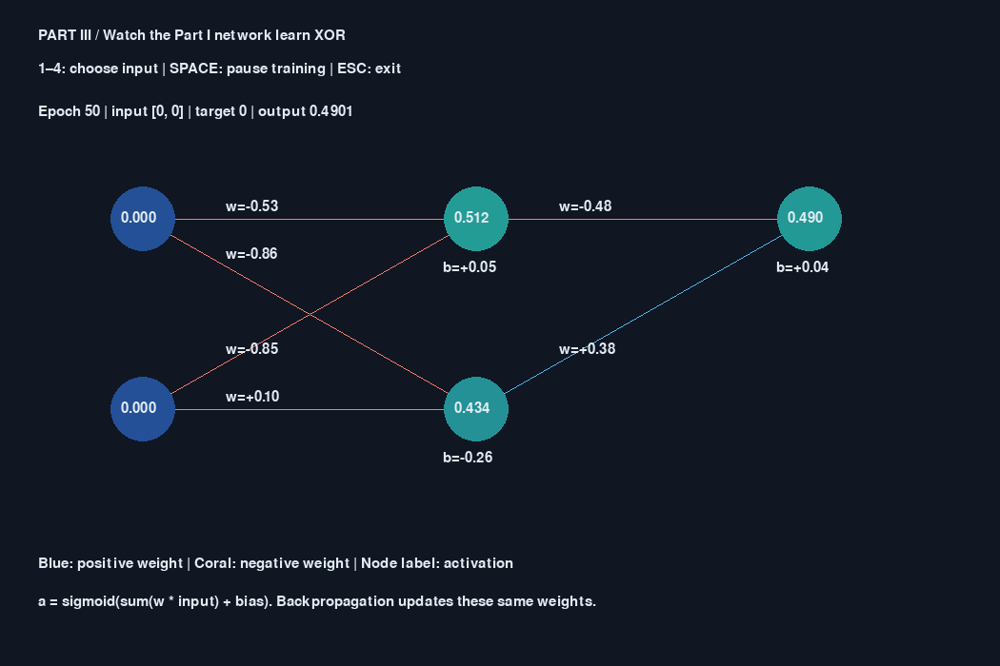
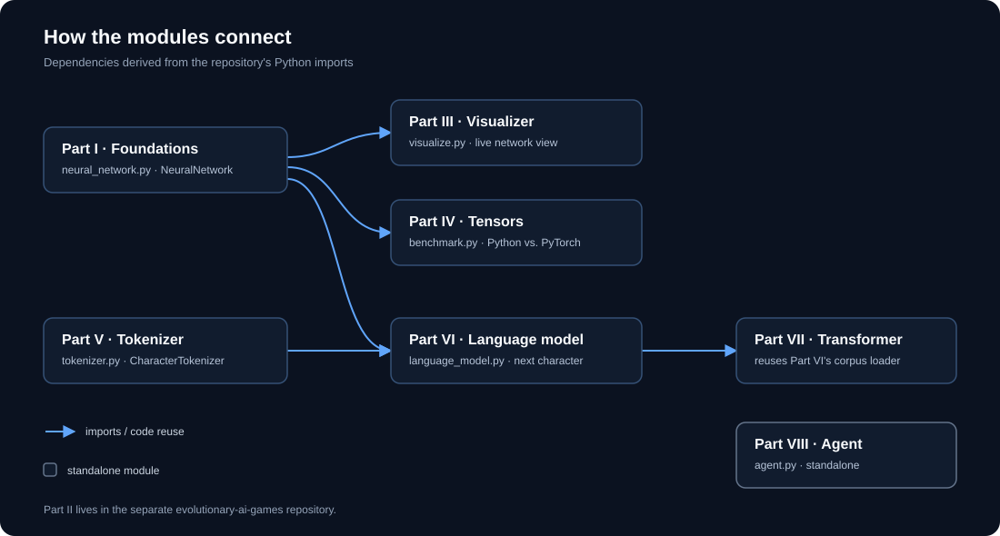
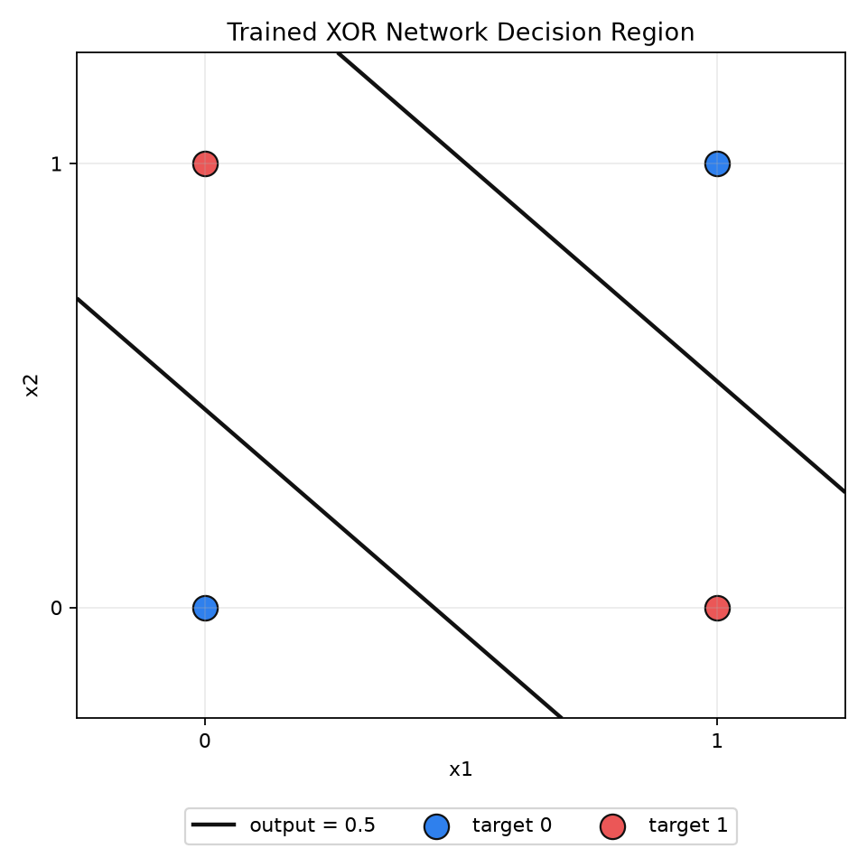
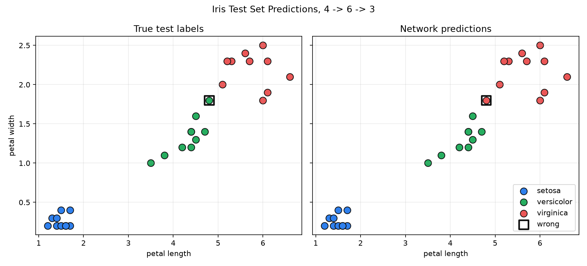

<div align="center">

# Understand AI

### A hands-on path from a single neuron to a tool-using language model

Build the mechanisms behind modern AI, inspect how they work, and compare their
outputs with recorded evidence.

[Learning path](#learning-path) · [Architecture](#how-the-modules-connect) ·
[Quick start](#quick-start) · [Results](#recorded-results)

<br>



<sub><b>Part III:</b> a live view of Part I's network. Node values show activations; edge values show weights updated during training.</sub>

<br>


</div>

> **Educational scope.** These compact experiments make mechanisms easier to
> inspect; they are not production training systems or broad performance claims.

## Learning path

| Part | Module | Focus |
|:---:|---|---|
| I | [Foundations](part_1_foundations/README.md) | Neurons, backpropagation, AND/XOR, Iris, and handwritten-digit experiments |
| II | [Evolutionary AI Games](https://github.com/Abrilolo/evolutionary-ai-games) | Separate Flappy Birds project using evolution and a game loop |
| III | [Network visualizer](part_3_visualizer/README.md) | Watch the Part I network learn XOR |
| IV | [Tensors](part_4_tensors/README.md) | Compare a Python forward pass with PyTorch tensors |
| V | [Tokenizer](part_5_tokenizer/README.md) | Character tokenization and byte-pair encoding |
| VI | [Language model](part_6_language_model/README.md) | Train a next-character predictor from scratch |
| VII | [Transformer](part_7_transformer/README.md) | Build explicit causal self-attention with PyTorch |
| VIII | [Local agent](part_8_agent/README.md) | Connect a local Ollama model to constrained tools |

Part II is a separate repository. Its absence here is intentional; the remaining
part numbers follow the original learning path.

## How the modules connect

This is a map of **actual imports**, not an aspirational architecture. The
arrows show where one part imports reusable code from another.

<p align="center">
  
</p>

| Module | Reuses | Relationship |
|---|---|---|
| III — Visualizer | Part I's `NeuralNetwork` | Shows the same implementation training, rather than a duplicate demo network |
| IV — Tensors | Part I's `NeuralNetwork` | Copies its weights and checks the tensor forward pass against Python |
| V — Tokenizer | — | Standalone character and byte-level BPE implementation |
| VI — Language model | Parts I and V | Trains the shared network with the character tokenizer |
| VII — Transformer | Part VI's corpus loader and split | Shares data preparation, not the neural network |
| VIII — Agent | — | Standalone client for a local Ollama model |

Part I and Part VI implement neural-network math in plain Python, without an
autodifferentiation framework. PyTorch is used for Part IV's tensor benchmark
and Part VII's transformer. Scikit-learn loads public datasets; it does not
train these models.

## Visual tour

<table>
  <tr>
    <td width="50%" valign="top">
      
      <b>Part I · Learning a nonlinear boundary</b><br>
      The trained network classifies the four XOR inputs, which a single linear boundary cannot separate.
    </td>
    <td width="50%" valign="top">
      
      <b>Part I · Inspecting model predictions</b><br>
      The square marks the one incorrect prediction in the recorded 30-row Iris test split.
    </td>
  </tr>
</table>

More generated plots and digit examples live in
[`part_1_foundations/assets/`](part_1_foundations/assets/). Part III's image
above is a headless preview; run the module to see training update live.

## Recorded results

These values come from the saved runs in this repository. They describe those
experiments only; benchmark timings are hardware-dependent, and the small
language-model runs are not controlled comparisons.

| Part | Recorded observation | Evidence |
|---|---|---|
| I — Foundations | Iris: 29/30 test rows correct (96.67%) in the recorded split. | [Plot](part_1_foundations/assets/plots/iris_6_hidden_neurons.png) · [README](part_1_foundations/README.md) |
| III — Visualizer | Preview captured at epoch 50; interactive training continues. | [Preview](part_3_visualizer/results/preview.png) |
| IV — Tensors | Error below `1e-12`; recorded CPU speedups of about 6.46× (one row) and 229.87× (256 rows). | [Benchmark](part_4_tensors/results/benchmark.json) |
| V — Tokenizer | Examples include English, Japanese, accented text, and emoji with exact valid-text reconstruction. | [Examples](part_5_tokenizer/results/examples.json) |
| VI — Language model | Validation NLL: 2.733 nats/token; add-one bigram baseline: 2.484. | [Metrics](part_6_language_model/results/metrics.json) |
| VII — Transformer | Validation NLL: 2.476 nats/token in the saved run; this does not isolate attention's effect. | [Metrics](part_7_transformer/results/metrics.json) |
| VIII — Agent | Saved trace records file-reading and arithmetic tool calls; two failed native-call attempts are retained. | [Transcript](part_8_agent/results/transcript.json) · [Failures](part_8_agent/results/) |

## Quick start

Run commands from the repository root. These examples use PowerShell.

```powershell
python -m venv .venv
.venv\Scripts\python.exe -m pip install -r requirements.txt
```

Try the progression:

```powershell
.venv\Scripts\python.exe -m part_3_visualizer.visualize
.venv\Scripts\python.exe -m part_4_tensors.benchmark
.venv\Scripts\python.exe -m part_5_tokenizer.tokenizer
.venv\Scripts\python.exe -m part_6_language_model.language_model --epochs 15
.venv\Scripts\python.exe -m part_7_transformer.transformer --steps 600
.venv\Scripts\python.exe -m part_8_agent.agent
```

### Approximate run times

> **Planning estimates only — these have not been timed for this README.**
> Actual duration varies with CPU, Python/PyTorch startup, and system load.
> Estimates exclude environment setup, package installation, and downloading
> Ollama models.

| Command | Rough estimate | Notes |
|---|---:|---|
| Part III — Visualizer | Interactive; stop with `Esc` | Continues training while the window is open |
| Part IV — Tensor benchmark | A few seconds | Includes warm-up and repeated measurements |
| Part V — Tokenizer | A few seconds | Small, self-contained examples |
| Part VI — Language model (`--epochs 15`) | Tens of seconds to a few minutes | Plain-Python training; duration grows with epochs |
| Part VII — Transformer (`--steps 600`) | Tens of seconds to a few minutes | CPU is supported; hardware affects training time |
| Part VIII — Local agent | Several seconds to a few minutes | Depends heavily on Ollama startup, model, and response latency |
| Part I — Iris / XOR scripts | A few seconds to about a minute | `compare_versions.py` may take longer because it runs multiple configurations |

Part I scripts are run directly:

```powershell
.venv\Scripts\python.exe part_1_foundations\neural_network.py
.venv\Scripts\python.exe part_1_foundations\compare_versions.py --no-menu
.venv\Scripts\python.exe part_1_foundations\part1_xor_network.py
```

Part VIII requires [Ollama](https://ollama.com) running locally with a
tool-capable model, for example:

```powershell
ollama pull qwen2.5-coder:3b
```

CPU is sufficient for the small PyTorch examples. Each module's README covers
its additional commands, prerequisites, and experiment-specific caveats.

## Implementation notes

- Scikit-learn is used only to load public datasets; Part I's model training is
  implemented in this project.
- Results may reflect one split, seed, corpus, or run. They should not be
  generalized beyond the evidence described by each part.
- Part VIII confines file reads to its data directory, parses arithmetic
  without `eval`, and limits tool rounds. These demo controls do not solve
  prompt injection or establish general agent reliability.
- Running experiments may overwrite files in each module's `results/` folder.

## References

- Vaswani et al., [Attention Is All You Need](https://arxiv.org/abs/1706.03762)
- [PyTorch tensors](https://docs.pytorch.org/docs/stable/tensors.html)
- [Ollama tool calling](https://docs.ollama.com/capabilities/tool-calling)
